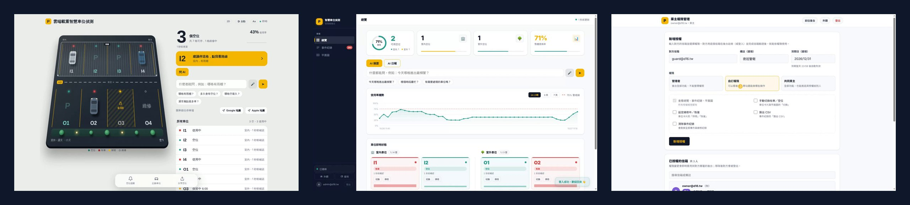
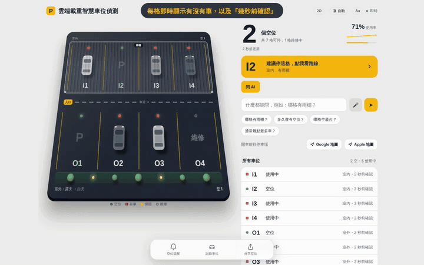
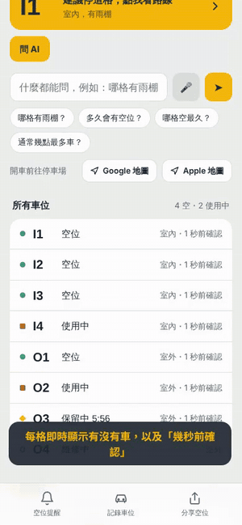
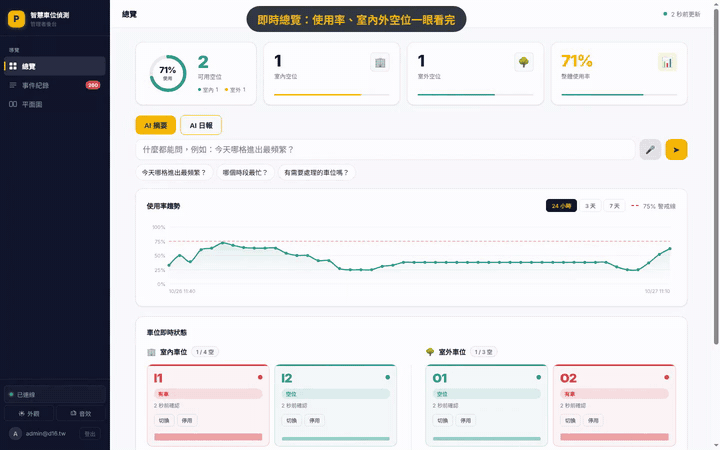
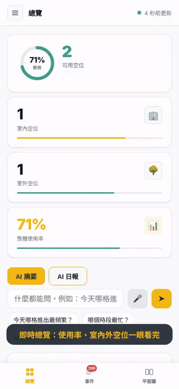
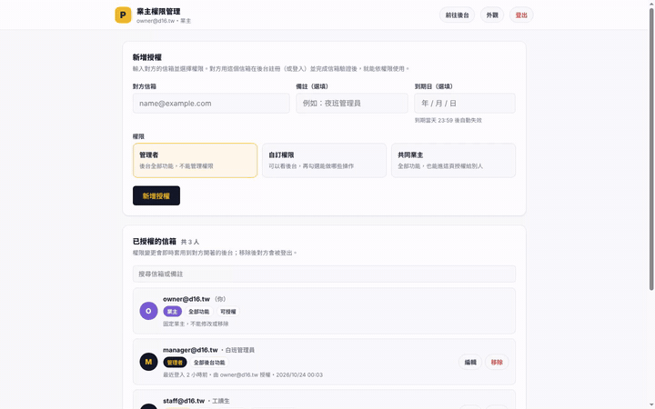
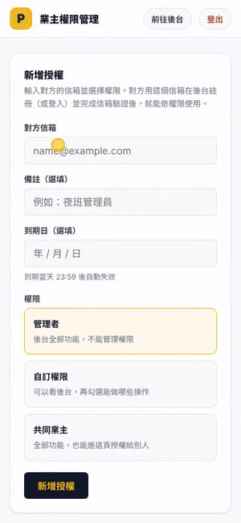
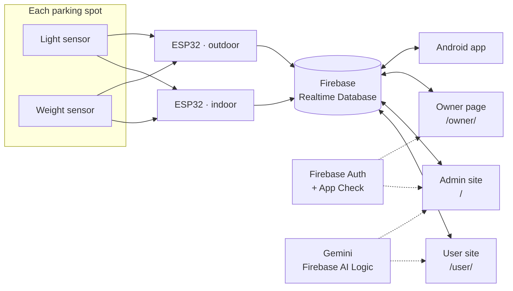

<h1 align="center">Smart Parking Spot Detection</h1>

<p align="center">
  Real-time parking availability from light + weight sensors, shown on three web front ends.<br>
  <b>Team D16</b> · NUTC Computer Science &amp; Information Engineering · Capstone Project
</p>

<p align="center">
  <a href="https://smart-parking-8df51.web.app/user/"></a>
  <a href="https://smart-parking-8df51.web.app/"></a>
  <a href="https://smart-parking-8df51.web.app/owner/"></a>
</p>

<p align="center">
  <a href="https://github.com/Black-tea666888/smart-parking-web/actions/workflows/deploy.yml"></a>
  
  
  
  
</p>

<p align="center"></p>

## Overview

Each parking spot has a **light sensor** and a **weight sensor**. Using both cuts false readings from shadows, people or objects left in the spot.
Two ESP32 boards (indoor and outdoor) push spot status to **Firebase Realtime Database**, and every page updates within about a second.

| | Page | Who it's for | Sign-in |
|---|---|---|---|
| [`/user/`](https://smart-parking-8df51.web.app/user/) | **User site** | Drivers looking for a spot | None |
| [`/`](https://smart-parking-8df51.web.app/) | **Admin site** | Parking lot staff | Verified email + owner approval |
| [`/owner/`](https://smart-parking-8df51.web.app/owner/) | **Owner page** | The lot owner | Owner account |

---

## User site · `/user/`

<table>
<tr>
<td width="70%"></td>
<td width="30%"></td>
</tr>
</table>

- **Live spot map**: an animated 2D / 3D view of indoor and outdoor spots with free, in-use, held and maintenance states
- **Suggested spot**: one tap shows the best free spot and the route to it
- **Navigation**: open the lot in Google Maps or Apple Maps
- **10-minute hold**: reserve a spot while you drive in
- **Find my car**: remember where you parked
- **Ask AI**: plain-language questions such as "which spots are free outdoors?", with voice input and spoken answers
- **Installable PWA** with offline shell, large-text mode and a QR code for sharing

## Admin site · `/`

<table>
<tr>
<td width="70%"></td>
<td width="30%"></td>
</tr>
</table>

- **Overview dashboard**: free spots, indoor / outdoor split and current occupancy
- **Usage trend** for 24 hours, 3 days or 7 days, with a busy-hour threshold line
- **Live spot cards**: switch a spot between in-use and free, or put it under maintenance
- **Event log** with search, filters and CSV export
- **Floor plan** view of every spot
- **AI summary and AI daily report** generated from the live data
- Access only after **email verification** and **approval by the owner**

## Owner page · `/owner/`

<table>
<tr>
<td width="70%"></td>
<td width="30%"></td>
</tr>
</table>

- **Grant access by email**: manager, custom or co-owner roles
- **Custom permissions**: view only, switch spots, set maintenance, export CSV, clear the log
- **Expiry date** for each grant, after which access ends automatically
- **Revoke** any grant instantly; the person is signed out of the admin site

> The recordings use demo data and placeholder accounts (`@d16.tw`).

---

## Architecture



## Language switch

Every page has a **中文 / EN** button in the bottom-left corner (`i18n.js`).
The choice is saved per browser, and the AI assistant, voice input and spoken answers follow the selected language.

## Tech stack

| Layer | Used |
|---|---|
| Front end | Plain HTML, CSS and JavaScript, no framework, no build step |
| Data | Firebase Realtime Database (live listeners) |
| Accounts | Firebase Authentication, email verification, App Check |
| AI | Gemini through Firebase AI Logic, with shared response cache |
| Hosting | Firebase Hosting, auto-deployed by GitHub Actions |
| Hardware | ESP32, light sensors, load cells |

## Repository layout

```
.
├── index.html          Admin site
├── user/               User site (PWA: manifest, service worker, icons, QR code)
├── owner/              Owner page
├── i18n.js             中文 / EN switch shared by all pages
├── sw.js               Removes the old user-page service worker
├── docs/               Screenshots and recordings for this README
├── firebase.json       Hosting config
└── .github/workflows/  Auto deploy
```

## Deploy

```bash
firebase deploy --only hosting
```

Every push to `main` also deploys through GitHub Actions (`.github/workflows/deploy.yml`) and appears under **Deployments**.
It needs the repository secret `FIREBASE_SERVICE_ACCOUNT_SMART_PARKING_8DF51` (created by `firebase init hosting:github`); without it the workflow only prints a warning.

`database.rules.json` is not in this public repository because it contains the owner's email.

## Team

**Team D16** · Day Division, CSIE Year 5, Class B · National Taichung University of Science and Technology

| Role | Name |
|---|---|
| Advisor | 周孝興 |
| Members | 蘇立庠 · 鄭羽紋 · 林家濬 |
